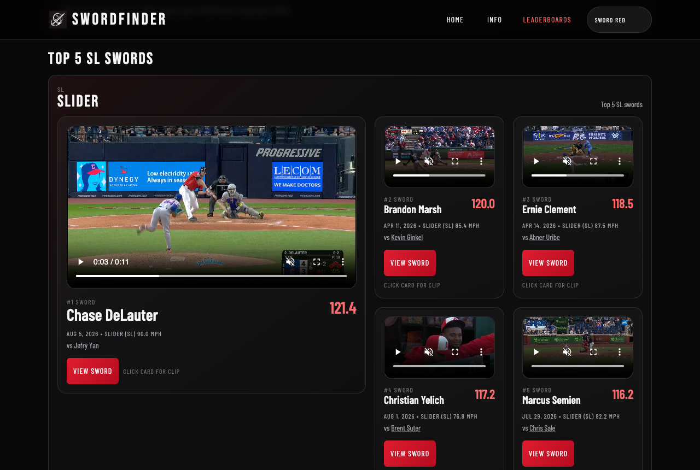

<div align="center">

# SwordFinder

**A live MLB data product for finding, scoring, watching, and sharing the ugliest strikeout swings in baseball.**

SwordFinder ranks "swords": two-strike swinging-strike moments where the hitter is so fooled that the bat dies out front. The site combines Statcast-derived pitch data, bat-tracking fields, a proprietary SwordFinder Score, cached MLB video clips, and shareable leaderboard views.

[](https://swordfinder.com)
[](https://swordfinder.com/ops)

[Try it](https://swordfinder.com) · [Ops diagram](https://swordfinder.com/ops) · [Sword info](https://swordfinder.com/sword-info.html)

<br />



</div>

---

## Why it exists

Baseball fans already know a sword when they see one: the swing is late, awkward, and over before the bat finishes. SwordFinder turns that baseball-internet moment into a ranked product:

- Which hitter got fooled the worst today?
- Which pitch type produces the nastiest swords?
- Which pitchers are inducing the most ugly strikeout swings?
- Which hitters are getting slain most often?

The important product rule is **No K, no sword**. A hitter can look terrible on pitch two and still win the at-bat on pitch three. SwordFinder focuses on the finished strikeout moment, because that is the clip people remember.

## Current Features

- **Daily sword slate** with date picker, top-five rankings, score metrics, and video-ready counts.
- **Pitch-type explorer** for season leaderboards by family or individual pitch type, such as fastballs, sliders, sinkers, cutters, and changeups.
- **Leaderboard views** for pitch types, hitter sword leaders, and pitcher sword leaders.
- **Shareable sword detail pages** at `/sword/{id}` with video, score breakdown, copy link, native share, and X intent.
- **Hitter and pitcher profiles** with historical sword rows and profile-specific clip hydration.
- **Sword Info page** with the term explainer, embedded source videos, and replayable first-visit onboarding.

## How It Works

1. **A GitHub Action runs every morning** (`.github/workflows/daily.yml`) and calls `pipeline/update.py`.
2. **It reads the previous days' pitches from Baseball Savant**, keeps the swords, and scores them.
3. **It finds each sword's clip**: the copy already in Azure Blob Storage if there is one, otherwise MLB's, which it copies in.
4. **It commits plain JSON to `ui/data/`.** Vercel deploys that as a static site.
5. **The browser reads the JSON directly** and filters it with `ui/assets/query.js`.

There is no database and no API server. That's on purpose: the first version ran on Supabase, Railway, Azure, Vercel and GitHub Actions, and when the database paused and the API disappeared, the site went dark. Nothing here can pause.

The daily run commits a check-in even when there are no games, which keeps GitHub from turning the schedule off. `/ops` shows the last check-in.

## Stack

- **Frontend:** static HTML, vanilla JavaScript modules, Tailwind built once to `ui/assets/tailwind.css` (see `tailwind.config.cjs`), custom CSS, on Vercel from `ui/`
- **Data:** `pipeline/update.py`, Python standard library plus `azure-storage-blob` for copying clips
- **Clips:** Azure Blob Storage
- **Automation:** one GitHub Actions workflow

## Key Routes

| Route | Purpose |
| --- | --- |
| [`/`](https://swordfinder.com) | Daily top-five sword slate |
| [`/leaderboards`](https://swordfinder.com/leaderboards) | Pitch-type, hitter, and pitcher leaderboards |
| [`/sword-info`](https://swordfinder.com/sword-info) | Explainer and source clips |
| [`/ops`](https://swordfinder.com/ops) | Last check-in and data counts |
| `/sword/{id}` | Shareable sword detail page |
| `/player/{id}` | Hitter sword profile |
| `/pitcher/{id}` | Pitcher sword-inducer profile |

## Run Locally

```bash
python3 pipeline/update.py --days 3 --clips 0   # refresh the data
cd ui && python3 -m http.server 3000
```

## Tests

```bash
python3 -m unittest discover -s tests
node --test tests/query.test.mjs
```

## Portfolio Notes

SwordFinder is useful as an end-to-end AI-assisted engineering case study:

- messy sports/data idea to live public product
- custom scoring model and domain-specific product rules
- data pipeline plus video pipeline
- a rewrite from five services to a static site after the first version went dark
- shareable artifacts for a real audience

It is intentionally framed as a working product/proof, not a finished media company.

## License

MIT for the project code. MLB/Statcast data and MLB video rights belong to their respective owners.
